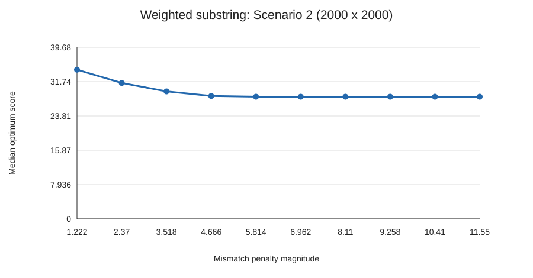
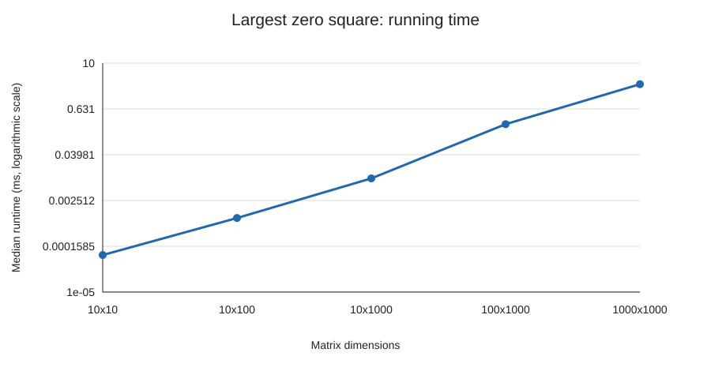
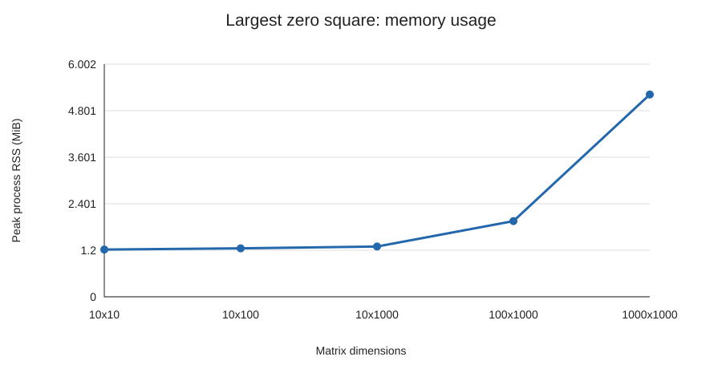

# Dynamic Programming: Weighted Approximate Common Substring and Largest Zero Square

## Interpretation and assumptions

The supplied assignment lost several inline mathematical expressions. With the selected defaults, Scenario 1 assigns every match weight 1 and every mismatch contribution −1. These values are assumptions, not recovered assignment requirements. The explicit alphabet `[A-Z]` is used; digits are excluded despite the assignment's use of “alphanumeric.” A substring is contiguous, both aligned substrings have the same length, and insertions/deletions are forbidden. Scores may restart at zero, allowing an empty optimum when no positive-scoring alignment exists. Matrix nonzero values are converted to one.

All reported coordinates are zero-based. DP equations below use one-based character/cell indices with sentinel row/column zero. Ties retain the first optimum endpoint encountered in row-major order. A zero-scoring prefix of a substring alignment is discarded, so a fixed endpoint's returned optimum is its shortest positive optimal suffix. No recursion is used in solution finding, extraction, data generation, or reference tests.

## Problem 1: Weighted approximate common substring

### Objective and Bellman optimality equations

Let the strings be $X=x_1\cdots x_m$ and $Y=y_1\cdots y_n$, with nonnegative match weights $w(c)$ and mismatch penalty magnitude $p\geq0$. Define

$$
s(a,b)=\begin{cases}w(a)&a=b,\\-p&a\ne b.\end{cases}
$$

The optimization objective is

$$
\max\left(0,\max_{\substack{1\leq a\leq m,\ 1\leq b\leq n\\1\leq L\leq\min(m-a+1,n-b+1)}}
\sum_{t=0}^{L-1}s(x_{a+t},y_{b+t})\right).
$$

Let $D[i,j]$ be the maximum of zero and the scores of equal-length contiguous alignments ending at $x_i,y_j$. Its Bellman equation is

$$
D[i,0]=D[0,j]=0,\qquad
D[i,j]=\max\bigl(0,D[i-1,j-1]+s(x_i,y_j)\bigr).
$$

The answer score is $\max_{i,j}D[i,j]$, including zero for empty inputs. Only the diagonal predecessor appears: the recurrence cannot skip a character in either string. Unlike a longest-common-substring recurrence, a mismatch does not automatically reset the state; a sufficiently valuable alignment can cross a mismatch.

### Correctness

Proceed by induction on increasing rows, and within each row increasing columns. Sentinel states correctly represent empty prefixes. Any nonempty alignment ending at $(i,j)$ is either length one or an alignment ending at $(i-1,j-1)$ with the final aligned character pair appended. The last contribution is identical for every such predecessor. A negative predecessor cannot improve the result over starting at the final pair; a zero predecessor can be replaced by the empty predecessor without changing its score. Thus the best available predecessor score is precisely $D[i-1,j-1]$. Appending the pair, then comparing with the empty alignment of score zero, gives the recurrence. Every positive choice is feasible because its predecessor is feasible and extension advances both indices by exactly one. The induction establishes both attainability and optimality of each state. Every candidate substring pair has an endpoint, so taking the global maximum gives the overall optimum.

### Iterative implementation and extraction

Maintain two arrays of scores and two arrays of alignment lengths, each of length $n+1$. Before processing row $i$, the previous arrays contain row $i-1$. At cell $(i,j)$, if the computed score is positive, set its length to the previous diagonal length plus one; otherwise set its length to zero. Record the score, length $L$, and zero-based starts $i-L,j-L$ whenever the score strictly improves the global maximum. Swap current and previous arrays after each row. Sentinel column zero remains zero.

Each positive state's saved length identifies an actual alignment realizing its score: this follows from the same induction as the score recurrence. After all cells are processed, take `X.substr(first_start, L)` and `Y.substr(second_start, L)`. This recovers both full strings, including any mismatches, with no traceback table or recursion. For a zero optimum, return empty strings and starts zero. For example, `AAAAZAAAA` versus `AAAAYAAAA` in Scenario 1 returns length 9, score 7, and both starts zero: eight matches outweigh the one mismatch.

The assignment's example aligns `CAABC` at one-based position 3 in `ABCAABCAA` with `CAACC` at one-based position 4 in `ABBCAACCBBBBBB`. This particular alignment has four matches and one mismatch, so it scores 3 under Scenario 1. It illustrates scoring; the solver still searches all alignments to find the global optimum.

### Time and space

There are $mn$ states with constant work per state. Input validation costs $O(m+n)$; extraction costs $O(L)$. For nonempty strings, total time is $O(mn)$; uniformly including empty inputs, it is $O(mn+m+n+1)$. DP auxiliary storage is $O(n)$, plus $O(L)$ for the returned strings and $O(m+n)$ for input storage. On the measured 64-bit platform, the four DP arrays contain $32(n+1)$ bytes of elements; the input character payload is $m+n$ bytes and the output character payload is $2L$. These counts exclude object headers, null terminators, spare capacity, and allocator overhead. The implementation preserves the given string order rather than swapping to the shorter dimension.

### Weight source and exact arithmetic

Scenario 2 weights are proportional to English letter frequency, using percentage-point values from the [Emory University English letter frequency table](https://mathcenter.oxford.emory.edu/site/math125/englishLetterFreqs/). They describe a reference distribution, not a universal distribution for every English corpus.

| Letter | Weight | Letter | Weight |
|---|---:|---|---:|
| A | 8.167 | N | 6.749 |
| B | 1.492 | O | 7.507 |
| C | 2.782 | P | 1.929 |
| D | 4.253 | Q | 0.095 |
| E | 12.702 | R | 5.987 |
| F | 2.228 | S | 6.327 |
| G | 2.015 | T | 9.056 |
| H | 6.094 | U | 2.758 |
| I | 6.966 | V | 0.978 |
| J | 0.153 | W | 2.360 |
| K | 0.772 | X | 0.150 |
| L | 4.025 | Y | 1.974 |
| M | 2.406 | Z | 0.074 |

Here $w_{\min}=0.074$ and $w_{\max}=12.702$. The ten strictly intermediate penalties are

$$
p_t=0.074+\frac{t}{11}(12.702-0.074),\quad t=1,\ldots,10.
$$

Let $f(c)=1000w(c)$, an integer. The implementation uses integer weights $11f(c)$ and penalty $11\cdot74+t(12702-74)$, then divides displayed scores by 11,000. This implements the fractions exactly, avoids floating-point tie drift, and preserves the optimum under a common positive scale. `int64_t` stores scores; the solver checks a conservative maximum-match-score bound before execution. Scenario 1 uses unscaled integer scores. Raw score magnitudes between scenarios are not directly comparable because their weight scales differ.

## Problem 2: Largest all-zero square

### Objective and Bellman optimality equations

For a Boolean $m\times n$ matrix $B$, maximize side length $k\geq0$ over top-left coordinates $(r,c)$ such that every cell of the associated $k\times k$ square is zero. Maximizing side length also maximizes area $k^2$.

Let $S[i,j]$ be the largest side length of an all-zero square whose bottom-right corner is $(i,j)$. Define

$$
S[0,j]=S[i,0]=0,
$$

$$
S[i,j]=\begin{cases}
0,&B[i,j]\ne0,\\
1+\min\{S[i-1,j],S[i,j-1],S[i-1,j-1]\},&B[i,j]=0.
\end{cases}
$$

The optimum is $k=\max_{i,j}S[i,j]$.

### Correctness

If the current cell is nonzero, no all-zero square can end there, so the value must be zero. Suppose it is zero and let $q$ be the minimum of the three predecessor values. Each predecessor contains an all-zero square of side $q$ ending at that predecessor. These three squares, together with the current cell, cover the entire side-$q+1$ square ending at $(i,j)$; when $q=0$, the current cell alone gives side one. Thus side $q+1$ is feasible.

Conversely, any feasible side-$k$ square with $k>1$ contains side-$k-1$ squares ending above, to the left, and diagonally above-left. All three predecessor values must therefore be at least $k-1$, implying $k\leq q+1$. A side-one square satisfies the same bound. Induction over row-major order proves the recurrence exact. Every feasible square has a bottom-right corner, so the largest state is the global optimum.

### Iterative implementation, extraction, and complexity

Store the matrix in a flat `uint8_t` array. Use one `uint32_t` DP array of length $n+1$. During a left-to-right row scan, `dp[j]` still holds the above value, `dp[j-1]` already holds the left value, and a saved variable holds the old diagonal. Save the above value before overwriting it, then use it as the diagonal for the next column.

Whenever a state strictly improves the best side $k$, record zero-based top-left coordinates $(i-k,j-k)$. The API returns these coordinates and the side; the CLI uses them to print the selected matrix cells. This descriptor identifies the complete optimal solution, so no traceback table is needed. If no zero exists, return side zero and coordinates zero.

The solver takes $O(mn)$ time and $O(n)$ auxiliary space for nonempty matrices. Empty dimensions return immediately. Input storage is $mn$ bytes; the DP elements occupy $4(n+1)$ bytes on the measured platform. Total retained input and working storage is $O(mn+n)$, while the returned descriptor is $O(1)$. Printing or materializing the extracted square takes $O(k^2)$ time, which does not exceed $O(mn)$. Matrix cells use at most a byte, but DP side lengths must use a wider type: the required 1000×1000 case can contain an all-zero square with side 1000.

## Experiments

String lengths are (100,100), (100,1000), (500,500), (1000,1000), and (2000,2000). Both strings are generated independently and uniformly over A–Z. Each pair is tested in Scenario 1 and at all ten intermediate penalties in Scenario 2. English frequencies determine Scenario 2's match weights; the assignment does not require English-frequency input generation.

The five matrix sizes are exactly 10×10, 10×100, 10×1000, 100×1000, and 1000×1000. Every cell independently has zero probability 0.5. String sizes and matrix density were unspecified, so these choices are explicit experiment settings. Both generators use `std::mt19937` with seeds 20261102–20261111; ten datasets are generated per configuration. Identical string pairs are regenerated across scoring settings for a fair comparison.

Each configuration runs in a separate optimized C++ process. After one warm-up, repeated solver calls are timed for at least 100 ms using `std::chrono::steady_clock`; elapsed time divided by call count gives the per-dataset time. Reported times are medians over the ten datasets. Timing includes allocation, validation, DP, and substring extraction, and excludes input generation and printing. A checksum consumes results. Process peak RSS is measured using `getrusage`; macOS reports bytes and Linux reports KiB, which are converted to bytes. RSS includes runtime and generation overhead, while calculated input/DP byte counts show the algorithms' array storage separately.

The experiments used an Apple M4, 16 GiB RAM, macOS 15.8.1 arm64, Apple Clang 17.0.0, and C++17 with `-O3`. A C++ experiment runner starts the benchmarks, computes CSV summaries, and writes SVG graphs directly without external plotting libraries. Raw per-seed measurements are in `results/raw.csv` and medians are in `results/summary.csv`. Timing and standard-library random distributions can differ across machines/toolchains.

### Problem 1 results

Scenario 1 results (medians over ten generated pairs):

| String lengths | Runtime (ms) | Score | Alignment length |
|---|---:|---:|---:|
| 100×100 | 0.011194 | 2 | 2 |
| 100×1000 | 0.115972 | 3 | 3 |
| 500×500 | 0.294095 | 3.5 | 3.5 |
| 1000×1000 | 1.167890 | 4 | 4 |
| 2000×2000 | 4.688410 | 4 | 4 |

Increasing alignment cells from 10,000 to 4,000,000 (400×) increased runtime by approximately 419×, consistent with the O(mn) state count. Fractional median lengths are the averages of the middle two integer observations.

Scenario 2 results for 2000×2000 strings are below. Results for all five sizes are in `results/summary.csv`. Scores use the percentage-point weight units specified above.

| Penalty | Runtime (ms) | Score | Alignment length |
|---:|---:|---:|---:|
| 1.222 | 6.591310 | 34.5050 | 9 |
| 2.370 | 5.527204 | 31.4340 | 6 |
| 3.518 | 5.208968 | 29.4835 | 6 |
| 4.666 | 5.022785 | 28.4220 | 3.5 |
| 5.814 | 5.103080 | 28.2535 | 3.5 |
| 6.962 | 4.850988 | 28.2535 | 3 |
| 8.110 | 4.783275 | 28.2535 | 3 |
| 9.258 | 4.731121 | 28.2535 | 3 |
| 10.406 | 4.727351 | 28.2535 | 3 |
| 11.554 | 4.715080 | 28.2535 | 3 |

Increasing the penalty from 1.222 to 11.554 decreased median score from 34.505 to 28.2535 and median selected length from 9 to 3. Larger penalties discourage alignments containing mismatches. Optimum score must be nonincreasing because every fixed alignment's score is nonincreasing with penalty. The observed length decrease is an experimental result, not a general monotonicity guarantee. The recurrence still evaluates every cell for every penalty.

### Problem 2 results

| Matrix | Runtime (ms) | Matrix bytes | DP bytes | Peak process memory (MiB) | Square side |
|---|---:|---:|---:|---:|---:|
| 10×10 | 0.000094 | 100 | 44 | 1.22 | 2 |
| 10×100 | 0.000873 | 1000 | 404 | 1.25 | 3 |
| 10×1000 | 0.009542 | 10000 | 4004 | 1.30 | 3 |
| 100×1000 | 0.251420 | 100000 | 4004 | 1.95 | 4 |
| 1000×1000 | 2.807990 | 1000000 | 4004 | 5.22 | 4 |

The largest matrix took approximately 2.81 ms per call. Runtime grows with the number of cells, though the per-cell constant varies with input size and hardware behavior. DP storage remains 4,004 bytes for all three matrices with 1000 columns; matrix storage grows from 10,000 to 1,000,000 bytes across those cases. This agrees with O(n) auxiliary space and O(mn) input storage. Process memory exceeds these array counts because it also includes the runtime, generator, and allocator overhead. The largest random matrix's median square side was 4; an all-zero 1000×1000 matrix would instead return side 1000.

## Correctness checks and running instructions

The retained C++ correctness checks compare both algorithms against exhaustive iterative solvers on small inputs, verify extracted solutions, and cover empty inputs, mismatches, unequal lengths, boundary squares, ties, and nonzero matrix values. A 300×310 all-zero case checks that DP side lengths can exceed 255 even though input cells use one byte. All 20,297 checks pass.

[README.md](README.md) gives the build, input, experiment, and correctness-check commands. All implementation, extraction, data generation, measurements, summaries, graph generation, and correctness checks are in C++17. Both DP solutions and extraction use no recursion.
